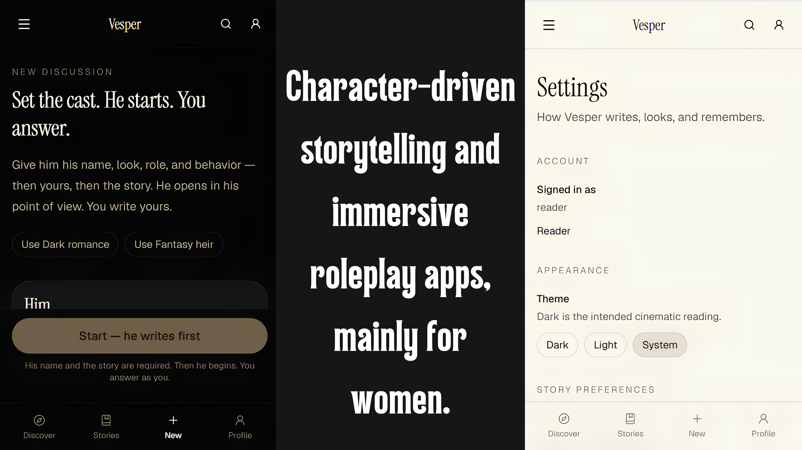

<p align="center">
  
</p>

<h1 align="center">Vesper</h1>

<p align="center">
  <em>Set the cast. He starts. You answer.</em><br>
  Character-driven storytelling and immersive roleplay, mainly for women.
</p>

<p align="center">
  <a href="https://chatbot-frontend-v1h7.vercel.app/"><b>Open the live app →</b></a>
</p>

<p align="center">
  
  
  
  
  
  
</p>

---

## The idea

Most chat apps wait for you to speak first. **Vesper flips it.**

You build the cast: his name, his look, his role, his behavior. Then you build yours. Then you choose the story. He opens the scene in his point of view, and you answer as yourself. The result reads like a novel you are writing together, one message at a time.

Everything you create is saved, so your stories, characters and settings are waiting for you the next time you open the app.

## How a story begins

1. **Set the cast.** Give him a name, a look, a role and a behavior, then add your own character.
2. **Pick a starting point.** Begin from scratch, or tap a preset such as *Dark romance* or *Fantasy heir*.
3. **Press Start.** The button says it all: *Start, he writes first.* His name and the story are required, and then he begins.
4. **Answer as you.** Reply in the chat and the story unfolds. Every discussion is stored in MongoDB.

## Screens

| Dark, the intended cinematic reading | Light, for daytime |
| :---: | :---: |
| **New Discussion**: set the cast and start the story | **Settings**: how Vesper writes, looks and remembers |

The app is mobile-first, with a bottom navigation of four places: **Discover**, **Stories**, **New** and **Profile**.

## Features

- **Character-driven stories.** Define the characters, then let the AI open the scene.
- **Chat-style play sessions.** Reply to the story message by message.
- **AI story generation** through OpenRouter, with fallback models if one is unavailable.
- **Guest sessions.** Try Vesper right away, no account needed, and sign up when you want to keep going.
- **Accounts and roles.** JWT authentication with `isAuth`, `optionalAuth` and `isAdmin` guards.
- **Profile and settings.** Account details, theme (Dark, Light or System) and story preferences.
- **Arabic translation** for readers who prefer it.
- **Image uploads** handled with Multer and Cloudinary.
- **Cinematic design.** Dark by default, with a serif display type, warm gold accents and generous space for reading.

## Tech stack

| Layer | Tools |
| --- | --- |
| **Front-end** | Next.js 16 (App Router), React 19, TypeScript, Tailwind CSS 4, Radix UI |
| **State** | React Context, localStorage (JWT and device ID) |
| **AI** | OpenRouter, via the front-end `/api/ai` route and the back-end story generator |
| **Back-end** | Node.js, Express 5, `serverless-http` |
| **Database** | MongoDB with Mongoose |
| **Auth** | JWT, bcrypt, guest sessions |
| **Media** | Multer, Cloudinary |
| **Hosting** | Vercel (and Netlify-ready through serverless) |

## Architecture

```text
            ┌──────────────────────────────┐
            │   Next.js app (App Router)   │
            │  UI · themes · translation   │
            └──────┬─────────────────┬─────┘
                   │                 │
        /api/ai    │                 │  REST + JWT
                   ▼                 ▼
          ┌──────────────┐   ┌────────────────────┐
          │  OpenRouter  │◄──┤   Express 5 API    │
          │  (AI models) │   │ auth · stories ·   │
          └──────────────┘   │ chats · uploads    │
                             └─────────┬──────────┘
                                       │
                          ┌────────────┴───────────┐
                          ▼                        ▼
                    ┌──────────┐            ┌────────────┐
                    │ MongoDB  │            │ Cloudinary │
                    └──────────┘            └────────────┘
```

## Getting started

**Requirements:** Node.js 18+, a MongoDB database, an OpenRouter API key and a Cloudinary account.

```bash
# 1. Back-end
cd backend
npm install
cp .env.example .env      # fill in the values below
npm run dev

# 2. Front-end (in a second terminal)
cd frontend
npm install
cp .env.example .env.local
npm run dev
```

Then open <http://localhost:3000>.

### Environment variables

Use the names from your own `.env.example` files. These are the values the app needs:

| Variable | What it is for |
| --- | --- |
| `MONGODB_URI` | Connection string of the MongoDB database |
| `JWT_SECRET` | Secret used to sign login tokens |
| `OPENROUTER_API_KEY` | Access to the AI models |
| `CLOUDINARY_CLOUD_NAME`, `CLOUDINARY_API_KEY`, `CLOUDINARY_API_SECRET` | Image uploads |
| `NEXT_PUBLIC_API_URL` | Address of the back-end, used by the front-end |

## Design notes

- **Dark first.** Dark is the intended cinematic reading. Light and System modes are one tap away in Settings.
- **Typography.** An elegant serif for titles and the wordmark, a clean sans-serif for reading and interface text.
- **Warm accent.** A muted gold on near-black, so the story stays the center of attention.
- **One thumb.** The main actions live in the bottom navigation and the sticky Start button.

## Deployment

The front-end is deployed on **Vercel**. The Express API is wrapped with `serverless-http`, so it can run on Vercel or Netlify as serverless functions.

## Built by

**Berry Studio**: websites with a bit of flavor.
